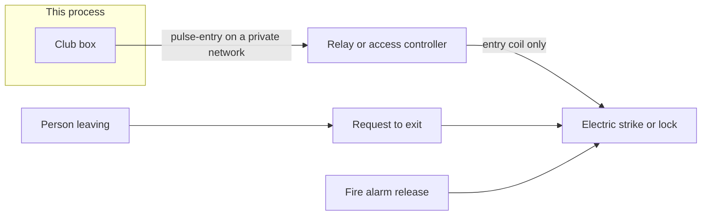

# Club box

A small self-hosted reference app for two club jobs:

1. **Court booking.** List courts and slots, hold one, pay a Lightning invoice, and confirm the booking when the invoice settles. An optional read-only Playtomic import can block the same court time.
2. **Member-area entry.** Enroll a Lightning wallet with LNURL-auth (LUD-04), or a cryptographic NFC card. A kiosk shows a rotating challenge QR. A valid wallet or card pulses an entry lock, records a check-in, and writes an audit row.

Both run in one Node process with SQLite. Payment processors and the door controller are adapters. The **mock** adapters need no Lightning node and no hardware, so you can try the whole flow on a laptop.

This is reference code, not a turnkey access-control product. Read the safety section before you connect a door.

> **Prototype — not yet tested with real money or real doors.**

## Safety

This process can send one command: a short **entry** pulse (`pulse-entry`).

- It cannot lock a door shut, hold a door closed, or control an exit.
- Leaving does not use this service. Request-to-exit, panic hardware, and fire-alarm release stay on circuits this software cannot reach.
- It does not touch fire or other life-safety systems.
- If the kiosk cannot reach the server, people use a fob, a PIN, or staff. Failed unlocks are not queued for later.
- Hours, if you set them, are checked when the QR is minted and again when the signature arrives. A closed area is not unlocked.
- Put any real relay on a private network. Do not publish an unauthenticated unlock URL.

Design the physical door with a licensed access-control installer and your fire marshal. Fail-safe versus fail-secure is a code decision for that door.

The same sentences are on the kiosk page, so they stay visible if the API is down. `GET /api/health` reports `controlsEgress: false` and `controlsLifeSafety: false`.

## License

Code in this directory is [AGPL-3.0-only](../../LICENSE). The playbooks that describe this design stay [CC BY-SA 4.0](../../LICENSE-docs). Commercial or other dual licensing is available on request. This page does not list prices.

## What you need

- Node.js 22.13 or newer (the Docker image uses Node 22)
- npm
- For a real door pulse: the example HTTP relay, or your own controller that accepts the same JSON

No Bitcoin node is required when `PAYMENT_BACKEND=mock`.

## Run locally with the mock backend

From this directory:

```bash
cp .env.example .env
```

Edit `.env`. You must set:

- `CURRENCY` — a 3-letter code you use for slot prices (for example the code your bookkeeper uses)
- `CURRENCY_DECIMALS` — digits after the major unit (often `2`)
- `ADMIN_TOKEN` — a long random string, at least 16 characters (`openssl rand -hex 24`)

Leave `PAYMENT_BACKEND=mock` and `DOOR_BACKEND=mock`. Leave price fields empty if you want to type every price in the admin page. `DEFAULT_SLOT_PRICE_MINOR` is optional and is only a helper for the generate-slots API.

```bash
npm ci
npm run dev
```

Open:

| Page | URL |
|---|---|
| Booking | http://127.0.0.1:3000/ |
| Admin | http://127.0.0.1:3000/admin |
| Door kiosk | http://127.0.0.1:3000/kiosk |
| Front desk | http://127.0.0.1:3000/desk |
| Guest form | http://127.0.0.1:3000/guest |
| Privacy | http://127.0.0.1:3000/privacy |
| Enrollment | linked from Admin after you add a member |

The database file is `./data/club.sqlite` unless you change `DATABASE_PATH`.

### Try a booking

1. On **Admin**, paste the admin token and load the page.
2. Add a court.
3. Add a slot. Type the price in **minor units** of `CURRENCY` (the smallest unit your currency uses). The form does not fill a price in for you.
4. On **Booking**, pick the slot and hold it. The page shows a QR and a mock invoice string that starts with `mock-not-payable:`. That string is not a payable BOLT11 invoice.
5. Back on **Admin**, use **Simulate payment** on that hold. The slot becomes a booking. A second visitor cannot hold the same slot while the hold is pending or after it is paid.
6. **Download CSV** saves bookings with the minor-unit amount and currency for your bookkeeper. The download sends the admin token; it is not a public link.

Unpaid holds expire after `HOLD_MINUTES` (default 15). A settlement that arrives after expiry does not create a booking; the slot opens again. A second settlement notice for the same invoice does not create a second booking.

To fill a day of slots without clicking each one, send `POST /api/admin/slots/generate` with the admin token and JSON:

```json
{
  "courtId": "crt_…",
  "date": "YYYY-MM-DD",
  "startTime": "HH:MM",
  "endTime": "HH:MM",
  "slotMinutes": 60,
  "priceMinor": 0
}
```

Replace `priceMinor` with your own integer in minor units. The `0` above is only a shape example and the server rejects it. `priceMinor` can be omitted only when `DEFAULT_SLOT_PRICE_MINOR` is set. Times are in `CLUB_TIMEZONE`. The admin page itself does not include this helper; it is an API.

### Try member entry

1. On **Admin**, add a member. The label is a membership number or similar handle. Do not store a person's name unless your privacy policy says so.
2. Open **Enrollment link**. The page shows an LNURL-auth QR tied to that member.
3. A wallet that supports LNURL-auth scans it and signs the challenge. The server stores the linking public key.
4. Open **Door kiosk**, pick an area from `ACCESS_AREAS`, and scan the rotating QR with the same wallet.
5. On a valid signature from an **active** enrolled member, the mock door records one entry pulse and the access log gains a row.

Without a wallet you can still confirm the kiosk renders, rotates, and states the safety rules. Automated tests sign challenges with an ephemeral key so the signature path does not depend on a wallet.

Revoke a member or a single key from Admin. A revoked member or key does not unlock. Restore returns a member to active; revoked keys stay revoked until the member enrolls again.

## Tests

```bash
npm test
npm run typecheck
```

The suite covers:

- LNURL-auth signature checks (compact, recoverable, and DER), a bad signature, expiry, replay, rate limits, revoked members, and area hours
- Invoice settlement for the mock backend, BTCPay Greenfield webhooks (HMAC, settled, expired), and LNbits webhooks (path secret, pending vs paid)
- Slot double-booking, including two concurrent claims, plus a price that changed under a player
- The example HTTP relay: it pulses on `pulse-entry` and rejects lock, fire, and egress commands

Tests use an ephemeral SQLite file and a fixture price of one minor unit. That number is not a club price.

## Configuration

Copy [`.env.example`](.env.example). It contains no real secrets. Prices are never hard-coded in the app: every slot stores the minor-unit amount you send, or `DEFAULT_SLOT_PRICE_MINOR` when you use the generate helper and omit `priceMinor`.

| Variable | Role |
|---|---|
| `HOST`, `PORT` | Bind address. Local default is `127.0.0.1:3000`. Compose sets `HOST=0.0.0.0`. |
| `DATABASE_PATH` | SQLite file. |
| `PUBLIC_BASE_URL` | Origin wallets and webhooks call. Must match the URL the phone can reach. |
| `CURRENCY`, `CURRENCY_DECIMALS` | Required. Slot currency and the scale of minor units. |
| `DEFAULT_SLOT_PRICE_MINOR` | Optional helper. Empty means every admin request must include `priceMinor`. |
| `SATS_PER_MINOR_UNIT` | Required for LNbits. BTCPay invoices in `CURRENCY` and converts itself. |
| `HOLD_MINUTES` | Unpaid hold lifetime. |
| `PAYMENT_BACKEND` | `mock`, `btcpay`, or `lnbits`. This is the Lightning backend only. |
| `BTCPAY_URL`, `BTCPAY_STORE_ID`, `BTCPAY_API_KEY`, `BTCPAY_WEBHOOK_SECRET` | Greenfield. Required when the backend is `btcpay`. |
| `BTCPAY_PAYMENT_METHOD` | Default `BTC-LN`. Some servers use `BTC-LightningNetwork`. |
| `LNBITS_URL`, `LNBITS_INVOICE_KEY`, `LNBITS_WEBHOOK_SECRET` | Required when the backend is `lnbits`. The secret is 16–128 characters from `[A-Za-z0-9_-]` because it sits in the webhook path. |
| `DOOR_BACKEND` | `mock`, `http`, `gpio`, or `serial`. Only `pulse-entry`. Fire release stays on hardware. |
| `DOOR_HTTP_URL`, `DOOR_HTTP_TOKEN`, `DOOR_HTTP_TIMEOUT_MS` | Required for `http`. Token at least 16 characters. |
| `DOOR_GPIO_PIN`, `DOOR_GPIO_ACTIVE_HIGH` | Required pin for `gpio`. Needs optional `onoff` on that host. |
| `DOOR_SERIAL_PATH` | Required for `serial`. One pulse line, then idle. |
| `DOOR_PULSE_MS` | Pulse length, 200–10000 ms. Default 3000. |
| `K1_TTL_SECONDS` | Challenge lifetime, 15–300. Default 90. |
| `RATE_LIMIT_WINDOW_SECONDS`, `RATE_LIMIT_MAX` | Callback and hold limits. |
| `CHALLENGE_RATE_LIMIT_MAX` | How often the kiosk may mint a new QR. |
| `ADMIN_TOKEN` | Required. Bearer token for `/api/admin/*`. At least 16 characters. Named staff logins are optional beside it. |
| `STAFF_TOKEN` | Optional shared desk token. At least 16 characters. |
| `ACCESS_AREAS` | Comma-separated ids such as `lounge,after-hours`. |
| `ACCESS_AREA_HOURS` | Optional `area=HH:MM-HH:MM` pairs. Empty means the area is allowed whenever the server is up. A window that wraps past midnight is written with the start later than the end. |
| `CLUB_TIMEZONE` | IANA name. Default `UTC`. Used for hours and generated slots. |
| `LOG_RETENTION_DAYS` | Access-log and old-challenge retention. Default 90. |
| `TRUST_PROXY` | `true` only behind a proxy that sets `X-Forwarded-For`. |

Admin routes expect `Authorization: Bearer <ADMIN_TOKEN>` or a staff session token. The admin page keeps that bearer token in `sessionStorage` for the browser tab. Password login also sets an `HttpOnly` cookie named `club_session`.

Provider choices (email, SMS, photo storage, backups, logs, staff bootstrap, Stripe, Square, player cancel, booking-door windows, and encrypted backups) are listed in [`.env.example`](.env.example) and [integrations](../../docs/manuals/10-integrations.md). Defaults are console mail, local files, Lightning only, and no GPIO. `CARD_PROVIDERS` stays empty until you set test or sandbox keys. Square Bitcoin is not an API method in this app.

## BTCPay Server

1. Create a store with Lightning enabled and a Greenfield API key that can create invoices.
2. Set `PAYMENT_BACKEND=btcpay` and the `BTCPAY_*` values. `PUBLIC_BASE_URL` must be the URL BTCPay can call.
3. In the store, add a webhook to `https://<your-host>/api/webhooks/btcpay` with the same secret as `BTCPAY_WEBHOOK_SECRET`. Send the invoice events that include settled, expired, and invalid.
4. The app creates a fiat invoice in `CURRENCY` for the slot's minor-unit amount, then reads the Lightning BOLT11 from the payment method named by `BTCPAY_PAYMENT_METHOD`.
5. A booking is confirmed only when the webhook signature matches and the event is `InvoiceSettled` (or the equivalent `invoice_settled`). `InvoiceExpired` and `InvoiceInvalid` release the hold. Other events are ignored.

The mock **Simulate payment** button is absent when this backend is selected.

## LNbits

1. Set `PAYMENT_BACKEND=lnbits`, the wallet invoice key, and `SATS_PER_MINOR_UNIT` (how many sats equal one minor unit of `CURRENCY` at the rate you choose to charge).
2. Set `LNBITS_WEBHOOK_SECRET`. The app registers `PUBLIC_BASE_URL/api/webhooks/lnbits/<secret>` as the invoice webhook.
3. A payment body with `pending: true` does not confirm a booking. A paid notice whose secret matches confirms it.

You choose the sats rate. The app does not look up an exchange rate.

## Door controller

`DOOR_BACKEND=mock` records pulses in memory and unlocks nothing physical. Use it for development.

`DOOR_BACKEND=http` POSTs JSON to `DOOR_HTTP_URL`:

```json
{
  "command": "pulse-entry",
  "area": "lounge",
  "pulseMs": 3000,
  "requestId": "aud_…"
}
```

The request uses `Authorization: Bearer <DOOR_HTTP_TOKEN>`, does not follow redirects, and is not retried. A failed pulse is written as `door-failed`. Retrying later could open the door after the member has walked away.

`gpio` pulses one pin through optional `onoff`, then returns the pin to idle. `serial` writes a single `pulse-entry` line to `DOOR_SERIAL_PATH`. Neither driver has a lock or fire-release command. The software never blocks egress. Fire-alarm release is wired at the hardware level.

### Example relay

[`examples/http-relay/server.mjs`](examples/http-relay/server.mjs) is the contract, not a GPIO driver. It accepts `pulse-entry` and rejects every other command, including lock, fire release, and egress.

```bash
RELAY_TOKEN="$(openssl rand -hex 24)" RELAY_HOST=127.0.0.1 RELAY_PORT=8787 node examples/http-relay/server.mjs
```

Point the app at it with `DOOR_BACKEND=http`, `DOOR_HTTP_URL=http://127.0.0.1:8787/pulse`, and the same token in `DOOR_HTTP_TOKEN`. Keep that port off the public internet. Wire a real board only to an entry strike. Exit hardware stays on another circuit.

## Docker Compose

```bash
cp .env.example .env
# set CURRENCY, CURRENCY_DECIMALS, ADMIN_TOKEN, and PUBLIC_BASE_URL
docker compose up --build
```

SQLite lives in the `club-data` volume at `/data/club.sqlite`.

The example relay is a separate profile and is not published on the host:

```bash
# .env also needs DOOR_BACKEND=http,
# DOOR_HTTP_URL=http://entry-relay:8787/pulse,
# and DOOR_HTTP_TOKEN
docker compose --profile relay up --build
```

Put TLS in front of the club-box port (Caddy, nginx, or similar). Set `PUBLIC_BASE_URL` to that HTTPS origin and `TRUST_PROXY=true` only if the proxy overwrites `X-Forwarded-For`.

## Offline and fallback

- Booking and enrollment need the server. A player who cannot reach it cannot hold a slot.
- Door checks use the local SQLite file. They do not call out to a wallet service. The wallet only needs to reach `PUBLIC_BASE_URL` to POST its signature.
- If the kiosk page cannot load, or the controller does not answer, staff use fobs, PIN, or the door in person. The software does not store a "unlock later" queue.
- Egress never depends on this process.

## Production notes

- Run one app instance per SQLite file. The double-booking guard is a transaction on that file.
- Back up the database. It holds slots, invoices ids, linking public keys, and the access log.
- Review the access log. Rows older than `LOG_RETENTION_DAYS` are deleted.
- Linking keys are site-specific public keys. A member label can stay a membership number. Name, phone, email, and a photo are optional profile fields for staff, stored on this server.
- Confirm your insurer is comfortable with wallet or card entry and any unstaffed hours.
- Refunds are a desk decision. This app records settlement; it does not send sats back.

## Compatible door hardware

Software in this app only sends a short entry pulse. A licensed locksmith or low-voltage installer does the physical work, with the fire marshal and the authority having jurisdiction. Nothing below is a certified product list. Brand names are examples of a category.

| Hardware | What to know |
|---|---|
| Electric strike | Fail-secure stays locked without power. Fail-safe unlocks without power. The choice is a code decision for that door. |
| Magnetic lock | Use one only where code requires free egress: a request-to-exit device and fire-alarm release on circuits this process cannot reach. |
| Electrified mortise or cylindrical lockset | The locksmith selects the function. This software still only pulses entry. |
| Smart lock or controller | Acceptable when it has a local HTTP API or a dry contact this app can pulse. Keep it on a private network. |
| Relay or access controller | A relay board (Shelly-class or ESP32-class boards are examples) or a controller with Wiegand or OSDP can sit between this app and the strike. Examples only. |



The request-to-exit and fire-alarm lines are not connected to this software.

Checklist before the door goes live:

- Power supply sized for the lock, with battery backup if the code or the insurer expects the entry side to keep working in an outage.
- Free egress without a phone, a card, power, or this server.
- Hardware that meets the accessibility requirement for that door.
- Review with the authority having jurisdiction and the fire marshal.
- A fob, PIN, or staff path that does not depend on this app.

## NFC member cards

Members can also unlock with a card. Prefer a cryptographic card:

- **NTAG 424 DNA** with SUN/SDM. The server checks an AES-CMAC and a rolling counter. The phone or a reader opens the card's HTTPS URL. The encrypted PICC data uses one club meta-read key, because the UID is inside that ciphertext and cannot be used to diversify the key first (NXP AN12196). The file-read key is diversified per card with the method in NXP AN10922.
- **MIFARE DESFire EV2 or EV3.** The reader finishes EV2 authentication. This server checks a truncated AES-CMAC over the UID and counter, using a per-card application key. The programming command in this repo personalizes NTAG 424 DNA. It does not replace a DESFire personalization tool.

A plain UID, or a cheap NTAG215, can be copied with a phone. UID-only mode exists only as `NFC_UID_MODE=insecure-dev`. It is off unless you set that. The kiosk shows a warning while it is on.

One member can hold several cards and several Lightning linking keys. Admin can enroll a card, revoke it, or mark it lost. Re-issuing a lost or revoked UID reactivates it and resets the counter. An active card cannot move to another member until it is revoked or marked lost.

Keys come from `NFC_MASTER_KEY` and `NFC_SDM_META_READ_KEY`, or from `NFC_KEYS_FILE`. Do not commit either. See [card programming](../../docs/nfc-card-programming.md).

A Bolt Card is a Lightning payment card that uses a similar chip. It is a separate product. Do not treat a payment card as a door credential, or a door credential as a way to pay.

Readers: a phone that opens the SUN URL, a USB/PC/SC reader at the kiosk (`npm run reader:bridge`), or the in-memory card used by the tests. `npm run card:program -- --dry-run` prints APDUs and does not need a reader.

## Profiles, check-in, and guests

Optional profile fields are a display name, phone, email, membership type, and a photo. Photos stay as files next to the database (`data/photos` by default) and are shown to staff and on the kiosk after a successful unlock. The public booking page does not receive them.

An unlock by wallet or card records a check-in. The kiosk shows the name and photo and can add a guest count. The front desk lists who is on site. Open visits expire after `CHECKIN_STALE_MINUTES` (default 480). Visit rows older than `VISIT_RETENTION_DAYS` are deleted. Marketing rows are not deleted on that schedule.

`GUEST_LIMIT` defaults to 0, so guests stay off until you set a cap. A member row can override it. Named guests need a waiver acknowledgement. The marketing checkbox is off unless the guest turns it on. That consent is stored apart from the visit, with the time and the consent-text version. Export `GET /api/admin/marketing.csv` for opted-in contacts only. Unsubscribe and deletion use the privacy token from the guest form.

Collect as little as you need. Staff routes accept the admin token or `STAFF_TOKEN`. This repository's notice template is [templates/privacy-notice.md](../../templates/privacy-notice.md). It is not legal advice. US state privacy laws, CAN-SPAM, TCPA for texts, and GDPR where it applies are local questions for a lawyer. The app does not send email or SMS.

## Read-only Playtomic sync

Playtomic's third-party API is optional. Set `PLAYTOMIC_CLIENT_ID`, `PLAYTOMIC_CLIENT_SECRET`, and `PLAYTOMIC_TENANT_ID` together, or leave all three empty. Credentials are created in Playtomic Manager under Settings, Developer Tools, on a Champion or Master plan. The default base URL is `https://thirdparty.playtomic.io`.

The client posts only to `/api/v1/oauth/token`. Bookings and payments are GET requests. Tokens last about an hour and are cached until shortly before expiry. A 401 refreshes once. Requests wait `PLAYTOMIC_MIN_GAP_MS` (default 60 seconds) because the API documents about one call per minute. HTTP 429 and the payments `202` snapshot response wait for `Retry-After`, then back off. Sync repeats every `PLAYTOMIC_SYNC_MINUTES` (0 means the admin **Sync now** button only). Upserts use the Playtomic booking id, so a second sync updates the same row.

Map each Playtomic `resource_id` to a local court in admin. Imported active bookings show on the court calendar without player emails. Lightning holds that overlap a mapped booking are refused. A canceled Playtomic booking stops blocking. If a court is unmapped, or an import overlaps a booking or hold that already exists, the desk gets a conflict flag.

At arrival, a member card or wallet, or a guest email, can match today's Playtomic booking by the linked player id or by email, and the check-in points at that booking.

Player email is personal data. It is stored so the desk can match a visit. It is copied into the marketing list only when Playtomic's `accepts_commercial_communications` is true. A later sync that reports false unsubscribes that Playtomic-sourced consent and leaves kiosk consents alone. Payment rows keep the payment ids, status, total text, dates, and product SKU. They do not keep payer names or tax ids.

This integration does not write bookings or payments back. Two-way sync is the [Playtomic Connect](https://playtomic.com/connect) partner program. Unofficial or scraped integrations are being blocked and must not be used. The public API only covers roughly the last three months plus future bookings.
